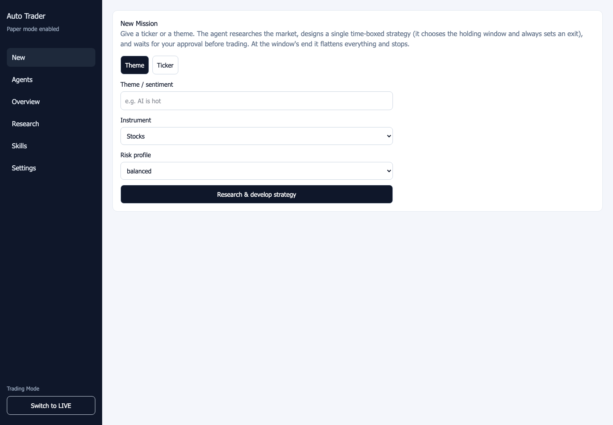

# Auto Trader

A local trading workspace with a FastAPI backend and Next.js dashboard. Generate
strategy drafts, inspect research, manage trading agents, and monitor an Alpaca
account from one interface.

The actual frontend, shown with an empty demo account and simulated paper-mode
response. No broker was connected, strategy generated, or order placed for this
capture. The image does not demonstrate trading results.

- Review generated strategies and their supporting research before creating agents.
- Activate or pause agents and inspect their run history and streamed events.
- View account balances, positions, and fill history for the selected account mode.

The application supports both paper and live trading. The default configured mode
is `paper`, but the selected mode persists and can be changed in settings. Active
agents can submit broker orders; agent activation can make an initial buy attempt.
This repository demonstrates a workflow, with no claim of trading performance.

## Run locally

Requires Python 3.11+, Node.js 20+, Alpaca credentials for the mode you use,
and an OpenAI API key for strategy generation.

Follow the [setup and runtime guide](GUIDE.md) to configure the backend, start the
API, and run the dashboard. Keep credentials in local environment files.
Confirm the selected trading mode before activating an agent.

The guide retains environment variables, API routes, scheduler behavior, order
handling, startup pause behavior, and verification commands. No live service or
account connection is implied by this README.
